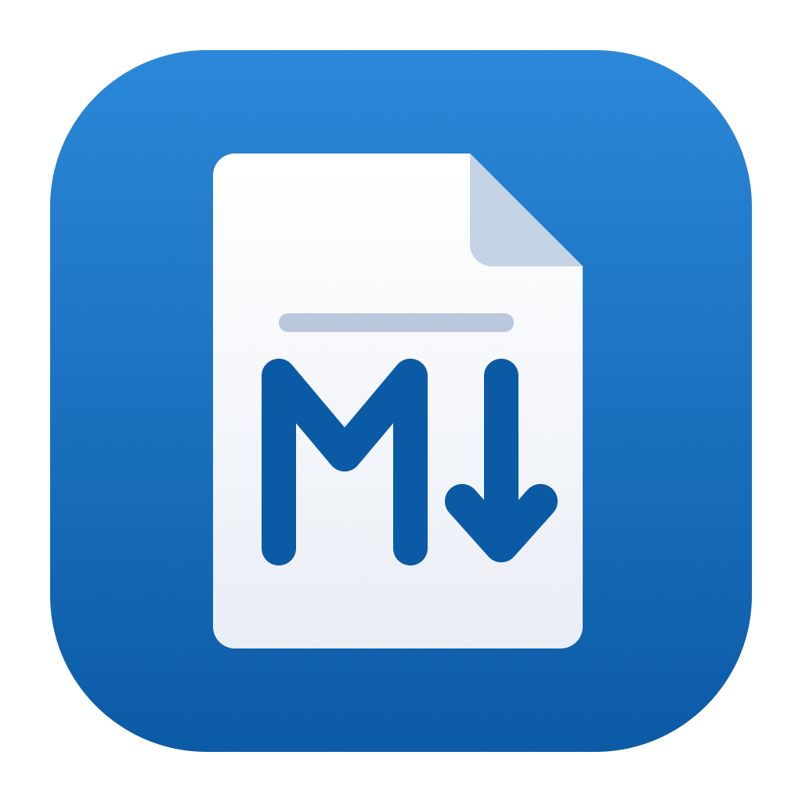
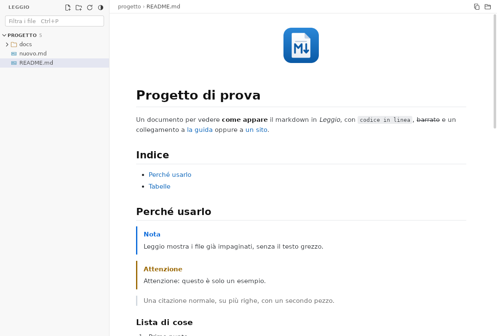

# Leggio

Un visualizzatore di file markdown, e basta. Si aprono file e cartelle, a
sinistra compare la lista dei `.md`, a destra il documento già impaginato:
niente editor, niente testo grezzo, niente Docker o vault da configurare.
Un solo eseguibile per Windows e per Linux.



## Cosa fa

- **Lista a sinistra** come l'Esplora risorse di VS Code: i file aperti uno
  per uno stanno in *Aperti*; ogni cartella aperta mostra il suo albero con
  tutti i file markdown dentro, sottocartelle comprese (salta le cartelle
  nascoste e `node_modules`).
- **Impaginazione completa**: tabelle, liste di attività, note a piè di
  pagina, codice colorato, emoji (`:rocket:`), riquadri `> [!NOTE]` di
  GitHub, immagini locali e remote, HTML dei README (`<details>`,
  `<p align="center">`, `<kbd>`), diagrammi **mermaid**.
- **Si aggiorna da solo**: se il file cambia su disco la vista si ricarica
  restando allo stesso punto; i file nuovi in una cartella aperta compaiono
  nella lista.
- **Collegamenti**: un link a un altro `.md` lo apre in Leggio (anche con
  `#sezione`), i link web vanno nel browser, gli altri file si aprono con il
  loro programma (immagini, PDF, documenti) o si mostrano nella cartella.
- **Una sola finestra**: aprire un altro file mentre Leggio è aperto lo
  aggiunge alla lista della finestra esistente.
- Tema chiaro, scuro o automatico; zoom del testo; si ricorda file e
  cartelle aperte alla prossima partenza.

## Usarlo

Gli eseguibili sono nella pagina
[Releases](https://github.com/AndreaSole/leggio/releases): `leggio.exe` per
Windows, `leggio-linux-amd64` per Linux.

### Windows

Serve Windows 10 o 11 (il motore WebView2 è già incluso nel sistema).

1. Copia `leggio.exe` dove vuoi, per esempio in `C:\Programmi\Leggio\`.
2. Per aprire i `.md` con un doppio clic: tasto destro su un file `.md` →
   **Apri con** → **Scegli un'altra app** → **Cerca un'altra app nel PC** →
   scegli `leggio.exe` e spunta **Usa sempre questa app**.

Si possono anche trascinare file e cartelle sulla finestra o
sull'eseguibile.

### Linux

Serve WebKitGTK 4.1, già presente su quasi tutti i desktop (Ubuntu 22.04 e
successive, Debian 12, Fedora, Mint...). Se manca:

```bash
sudo apt install libwebkit2gtk-4.1-0
```

Poi:

```bash
chmod +x leggio-linux-amd64
./leggio-linux-amd64 --install
```

`--install` aggiunge Leggio al menu delle applicazioni e lo rende il
programma predefinito per i `.md` (solo per il tuo utente, niente `sudo`).
`--uninstall` lo toglie. Se sposti l'eseguibile, rilancia `--install`.

Da terminale: `leggio file.md cartella/ altro.md`.

## Scorciatoie

| Tasti | Cosa fa |
|---|---|
| <kbd>Ctrl</kbd>+<kbd>O</kbd> | Apri file |
| <kbd>Ctrl</kbd>+<kbd>Maiusc</kbd>+<kbd>O</kbd> | Apri cartella |
| <kbd>Ctrl</kbd>+<kbd>P</kbd> | Filtra i file per nome (<kbd>Invio</kbd> apre il primo) |
| <kbd>Ctrl</kbd>+<kbd>F</kbd> | Cerca nel documento (<kbd>Invio</kbd> / <kbd>Maiusc</kbd>+<kbd>Invio</kbd> per scorrere) |
| <kbd>↑</kbd> <kbd>↓</kbd> | Nella lista: file precedente / successivo |
| <kbd>←</kbd> <kbd>→</kbd> | Nella lista: chiudi / apri cartella |
| <kbd>Ctrl</kbd>+<kbd>B</kbd> | Nascondi / mostra la barra laterale |
| <kbd>Ctrl</kbd>+<kbd>+</kbd> <kbd>Ctrl</kbd>+<kbd>-</kbd> <kbd>Ctrl</kbd>+<kbd>0</kbd> | Zoom del testo (anche <kbd>Ctrl</kbd>+rotellina) |
| <kbd>Ctrl</kbd>+<kbd>W</kbd> | Togli il file dalla lista *Aperti* |
| <kbd>F5</kbd> | Rileggi file e cartelle |

## Sicurezza

I file markdown possono contenere HTML. Leggio lo ripulisce come fa GitHub:
niente script, iframe, form o stili in linea, e un collegamento in un README
non può lanciare un programma (gli eseguibili si mostrano nella loro
cartella, non si aprono). Le immagini remote nei documenti vengono scaricate,
come su GitHub.

## Dove salva le cose

Le cartelle e i file aperti, il tema e la larghezza della barra stanno in
`%AppData%\Leggio\stato.json` su Windows e in `~/.config/Leggio/stato.json`
su Linux.

## Compilare

Serve Go 1.26 e la CLI di [Wails](https://wails.io) v2
(`go install github.com/wailsapp/wails/v2/cmd/wails@v2.17.0`).

```bash
wails build -platform windows/amd64 -skipbindings -trimpath   # build/bin/leggio.exe, anche da Mac o Linux
scripts/build-linux.sh amd64                                  # build/bin/leggio-linux-amd64, dentro Docker
go test ./...
```

La versione Linux si compila in Docker su Ubuntu 22.04, così l'eseguibile
parte anche sulle distribuzioni meno recenti. Sul Mac basta `wails build`
per avere `Leggio.app`, comodo per provare.

Com'è fatto: Go con [Wails](https://wails.io) usa il motore web del sistema
(WebView2 su Windows, WebKitGTK su Linux), quindi niente Chromium da 150 MB
dentro. Il markdown lo converte
[goldmark](https://github.com/yuin/goldmark), il codice lo colora
[chroma](https://github.com/alecthomas/chroma), l'HTML lo ripulisce
[bluemonday](https://github.com/microcosm-cc/bluemonday). I diagrammi li
disegna [mermaid](https://mermaid.js.org) (licenza MIT), che sta compresso
dentro l'eseguibile e si carica solo se un documento ne contiene uno.

## Licenza

MIT, vedi [LICENSE](LICENSE). Le licenze delle librerie incluse negli
eseguibili (tutte MIT, BSD, ISC o Apache 2.0) sono in
[THIRD_PARTY_LICENSES.txt](THIRD_PARTY_LICENSES.txt); si rigenera con
`python3 scripts/licenses.py` dopo aver compilato.
